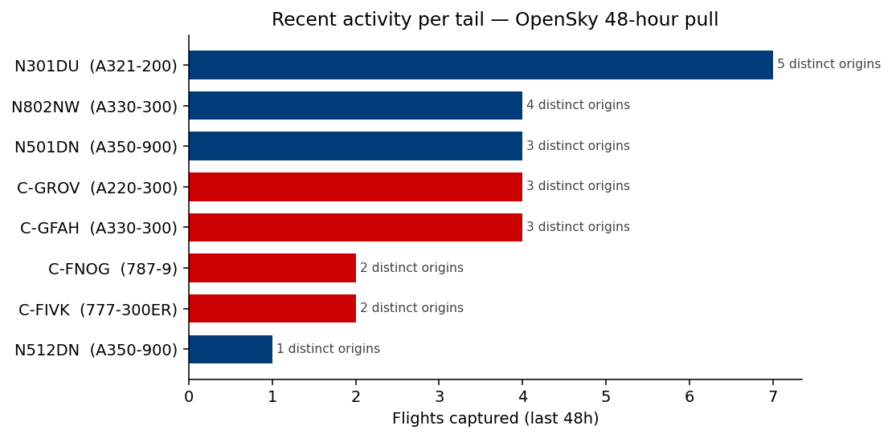
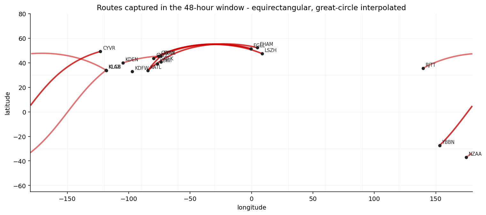

# Fleet Tracker

**Evidence-first airline operational reliability research and exploratory fleet tracking using public aviation data.**

**Start here:** [Airline Operational Performance & Reliability case study](https://yumorepos.github.io/airline-operations.html) · [BTS source/KPI validation](docs/BTS_DELTA_PILOT_2025_RESULTS.md) · [Independent aircraft-connection audit](docs/BTS_TAIL_SEQUENCE_2025_RESULTS.md) · [Origin and reported-delay profile](docs/BTS_DELTA_SEGMENT_2025_RESULTS.md) · [CI checks](https://github.com/yumorepos/fleet-tracker/actions)

## Verified research: Delta domestic operational reliability

**Business question:** What can public reporting-carrier data reliably say about arrival punctuality, cancellations and *candidate* aircraft connections, and where would an operations analyst investigate next?

- **Population:** January and July **2025** BTS Reporting Carrier On-Time Performance records filtered to `Reporting_Airline=DL`: **76,306** January and **94,066** July scheduled domestic reported operations. These are two separate snapshots, **not** the full Delta-marketed network.
- **Verified descriptive KPIs:** among non-canceled, non-diverted records with valid arrival flags, **80.68%** of January flights and **75.16%** of July flights arrived within 15 minutes of schedule. Cancellation rates were **2.80%** and **1.40%**, respectively, using all scheduled reporting-carrier records as the denominator.
- **Operational segmentation:** ATL-origin flights had lower observed arrival punctuality than other origins in both samples (**4.77 percentage points** in January; **7.03 points** in July). This does not identify an ATL process problem or its cause.
- **Follow-up research:** [Verified departure-bank and selected shared-destination comparison](docs/BTS_DEPARTURE_BANK_DESTINATION_MIX_2025_RESULTS.md) breaks the same two-month sample into origin-local scheduled periods, with independently checked SQL counts and explicit matched-sample coverage. Patterns vary between the sampled months; no scheduling-bank or airport causal effect is established.
- **Daily robustness:** [Independently verified threshold, day-type and leave-one-day-out sensitivity](docs/BTS_DAILY_ROBUSTNESS_2025_RESULTS.md) tests the same two historic months against 10/25/50-flight matching thresholds, distinguishes selection from reweighting, and identifies low-coverage weekend comparisons. Daily exclusions do not change the sign of the matched gap but do change its magnitude; no causal or formal confidence-interval claim is made.
- **Day-level statistical sensitivity:** [Paired-day and three-day-block resampling audit](docs/BTS_DAY_RESAMPLING_2025_RESULTS.md) independently rechecks 1,200 date-weighted comparisons against official BTS sources. It finds the **July standardized ATL-origin gap can reverse sign** under both predeclared resampling methods, despite the earlier 31 single-day omissions not reversing it. Percentile ranges are *descriptive stability diagnostics*, **not confidence intervals or causal estimates**.
- **Candidate connections:** same-tail/same-airport observed pairs were screened using verified local-to-UTC gate times and a **20–360-minute** ground interval. Missing flights, assignments and reporting coverage prevent claims about complete rotations, actual fleet utilization or causal delay propagation.
- **Verification:** original source archive hashes and count contracts were checked; a separate SQLite implementation independently reproduced the population counts, candidate-pair counts and delay-association groups. See the linked methods/results and the repository's [test workflow](https://github.com/yumorepos/fleet-tracker/actions/workflows/tests.yml).

**Decision boundary:** The study supports historical KPI reporting and prioritizing questions for further investigation. It does **not** show a seasonal effect, an operational intervention, a prediction model or preventable airline savings.

## Separate exploratory work: fleet and aircraft activity tracking

The original Fleet Tracker prototype collects sampled OpenSky flight activity and distinguishes tail-level metadata from airline-fleet type summaries. Its data model, notebook audits and exploratory visualizations remain useful for engineering demonstrations, but public ADS-B coverage is incomplete and this is **not** a verified inventory of every aircraft movement, aircraft ownership history, cabin retrofit or active airline fleet.

The repository includes a working authenticated OpenSky collector, a Wikipedia fleet-type collector and exploratory notebooks. Other collector interfaces and the Astro dashboard are incomplete or prototype work. An older airline-press collector [PR #10](https://github.com/yumorepos/fleet-tracker/pull/10) remains unmerged; it should not be represented as a production capability.

## Current operational status

The BTS studies are merged research artifacts, not an always-on flight-monitoring service. The current `nightly-collection.yml` is an intentionally **disabled, manual-only placeholder**; no scheduled collection is configured. BTS validation workflows are also manual/research-focused. Consult [GitHub Actions](https://github.com/yumorepos/fleet-tracker/actions) for dated test evidence rather than treating a historical test count as permanent.

## Stack

- Python 3.12+, managed with `uv`
- DuckDB for the query layer, Parquet for flight history (Hive-partitioned by airline / year / month)
- OpenSky Network for live flights (authenticated tier)
- Static site generated with Astro for the dashboard (Phase 4)
- GitHub Actions run automated tests on pushes and pull requests; BTS research verification is manually triggered, and recurring fleet collection remains disabled

## Layout

```
src/fleet_tracker/        Python package
data/reference/           Hand-curated fleet rosters
data/flights/             Parquet archive (gitignored)
data/cache/flights/       24h fetch cache (gitignored)
docs/                     Research, design, plan, methodology
docs/img/                 Charts rendered from notebooks/
tests/                    Pytest suite
notebooks/                Jupyter analysis (01-02 populated; 03 Phase 4)
site/                     Astro dashboard (Phase 4)
```

See [docs/DESIGN.md](docs/DESIGN.md) for the architecture, [docs/PLAN.md](docs/PLAN.md) for the build sequence, and [docs/RESEARCH.md](docs/RESEARCH.md) for the data-source landscape.

## Running locally

### Verify the Delta/SQLite case study (no aviation-data credentials)

With Python 3.12+ and [uv](https://docs.astral.sh/uv/) installed, run from the repository root:

```bash
uv sync --frozen
uv run pytest -q tests/test_bts_reliability_accepted_aggregates.py tests/test_bts_reliability_mart.py
```

These tests build and query a temporary SQLite reporting database using the **committed, previously source-verified January/July 2025 Delta aggregate fixture**, and check reporting ratios, integrity, input rejection, and overwrite protection. They require **no BTS download, OpenSky connection, or aviation API credentials**; the initial dependency installation may still require internet access.

**Evidence boundary:** Passing these tests demonstrates aggregate-to-SQL transformation and regression parity, **not** a fresh independent download, checksum verification, or flight-level reanalysis of BTS source archives. See [SQLite reporting method](docs/BTS_RELIABILITY_SQLITE_MART.md), [original BTS source/KPI validation](docs/BTS_DELTA_PILOT_2025_RESULTS.md), and [independent origin/cause audit](docs/BTS_DELTA_SEGMENT_2025_RESULTS.md) for the historical source-validation evidence and scope limits.

### Full tests and separate exploratory OpenSky collector

```bash
# Install
uv sync

# Run tests
uv run pytest

# Vertical slice: pull recent flights for one Air Canada tail
cp .env.example .env  # then add your OpenSky credentials
uv run python -m fleet_tracker.collectors.opensky --tail C-GROV --hours 48
```

The seed CSV at `data/reference/ac-mainline.csv` carries an `icao24` column populated for the tails the data-quality audit verified (4 of 7 AC tails, 4 of 6 DL tails — see notebook 01). Tails still marked `todo_lookup` need their icao24 populated before `--tail` mode works for them; pass `--icao24 <hex>` directly until then.

## Sample output

A real slice run against C-GROV (an AC A220-300 on dense North American routes):

```
opensky: GET /flights/aircraft icao24=c0730e window=[2026-05-04T00:00:00+00:00, 2026-05-05T23:59:59+00:00] auth=oauth
opensky: wrote cache C-GROV_20260506.json (4 records)
opensky[C-GROV]: 4 flights, null estDepartureAirport=0 (0.0%), null estArrivalAirport=1 (25.0%) — exceeds 5% threshold from DESIGN §1

4 flights for C-GROV (icao24=c0730e) over last 48h:
  2026-05-05 21:37  CYUL -> ???   (ACA1573)
  2026-05-05 17:36  KATL -> CYUL  (ACA1570)
  2026-05-04 21:25  CYUL -> KATL  (ACA1573)
  2026-05-04 15:50  KDEN -> CYUL  (ACA1072)

Wrote data/flights/airline=ac/year=2026/month=05/flights.parquet

Aggregate: distinct origin airports for C-GROV:
  CYUL  2
  KATL  1
  KDEN  1
```

The single null `estArrivalAirport` is a structural OpenSky pattern at smaller airports, not a bug — see "Notes on the data" below. The collector preserves nulls rather than guessing.

## What it looks like

Two notebooks render real OpenSky data inline on GitHub.

**`notebooks/01-fleet-overview.ipynb`** — composition, data-quality audit (seed CSV vs OpenSky metadata), MSN-mismatch investigation, recent activity per tail, and the ownership-ingestion path that activates the observation-table surface DESIGN §2 promised. The audit catches a real bug: the seed listed N301DU as an A321-200, OpenSky says it's an A220.



**`notebooks/02-route-density.ipynb`** — pivots cached flight data into route segments, charts the top routes, and renders a rough great-circle map (an exploratory equirectangular version; the production Winkel-tripel SVG renderer per DESIGN §5 lands in Phase 4).



To re-run:

```bash
uv sync --group notebook
uv run jupyter nbconvert --to notebook --execute --inplace notebooks/01-fleet-overview.ipynb
uv run jupyter nbconvert --to notebook --execute --inplace notebooks/02-route-density.ipynb
```

## Contributing

If you work on a fleet planning team and notice something off in this data, please open an issue. Better to be corrected than wrong.

## Notes on the data

OpenSky's `estDepartureAirport` field is frequently null at smaller airports with weaker ADS-B ground coverage. The tracker preserves these null values rather than guessing; the per-tail dashboard view (Phase 4) will render flights with unknown origin as "? → DEST" rather than dropping them.

Airport codes throughout the project are ICAO (CYUL, KATL), not IATA (YUL, ATL). This matches what OpenSky natively returns. ICAO → IATA display conversion happens at render time.

## Sources and ethics

The Delta research uses official [BTS monthly reporting-carrier records](https://transtats.bts.gov/PREZIP/) under [BTS 2025 Technical Directive #39](https://www.bts.gov/explore-topics-and-geography/modes/aviation/number-39-technical-directive-reporting-time). Only aggregate results are committed for the study; raw flight-level research records are not published here.

The exploratory fleet work uses public data. See [docs/data-sources.md](docs/data-sources.md) for source-specific constraints and [docs/ethics.md](docs/ethics.md) for the principles that shape what is collected, displayed, and not displayed.

## Licence

MIT. See [LICENSE](LICENSE).
