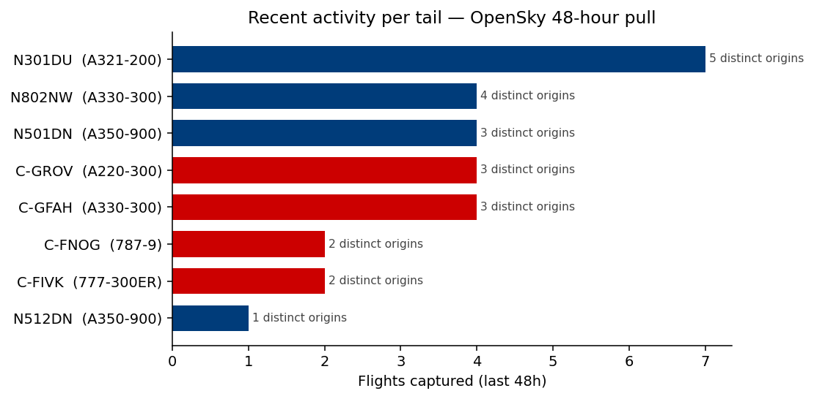
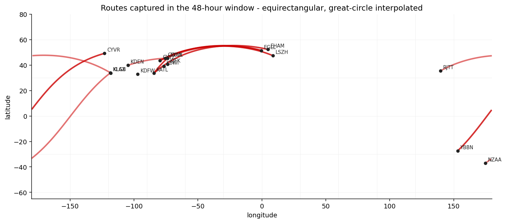

# Fleet Tracker

Tracking current and historical fleets of major airlines, with per-aircraft history.

## What this is

Fleet Tracker maintains a tail-by-tail record of an airline's fleet: which aircraft are flying, who owns them, where they've been, and how their cabins are configured. v1 covers Air Canada and Delta Air Lines mainline operations.

The project answers questions that public fleet pages typically don't:

- For any given tail number, what does its history look like?
- Who currently owns it, who used to, and when did the leases turn over?
- Which sub-fleet variant is it, and when was the last cabin retrofit confirmed?
- Where has it flown over the time we've been watching?

## Status

Active development. The repository contains the data model, schema, full test suite (92 tests), a working OpenSky live-flight collector with OAuth authentication, a working Wikipedia airline-fleet collector (type-level signal), and `notebooks/01-fleet-overview.ipynb` — a fleet composition + data-quality-audit notebook with two distinct signal kinds (`ownership` from OpenSky per-tail metadata, `fleet_membership` from Wikipedia type-level data) writing into the observations table. Remaining collectors (Planespotters photos, airfleets ownership, AeroLOPA seat maps, airline press) are stubbed for Phase 4 with their interfaces defined. The Astro dashboard lives in `site/` and is also Phase 4 work.

## Stack

- Python 3.12+, managed with `uv`
- DuckDB for the query layer, Parquet for flight history (Hive-partitioned by airline / year / month)
- OpenSky Network for live flights (authenticated tier)
- Static site generated with Astro for the dashboard (Phase 4)
- GitHub Actions for nightly collection (Phase 4)

## Layout

```
src/fleet_tracker/        Python package
data/reference/           Hand-curated fleet rosters
data/flights/             Parquet archive (gitignored)
data/cache/flights/       24h fetch cache (gitignored)
docs/                     Research, design, plan, methodology
docs/img/                 Charts rendered from notebooks/
tests/                    Pytest suite
notebooks/                Jupyter analysis (01-02 populated; 03 Phase 4)
site/                     Astro dashboard (Phase 4)
```

See [docs/DESIGN.md](docs/DESIGN.md) for the architecture, [docs/PLAN.md](docs/PLAN.md) for the build sequence, and [docs/RESEARCH.md](docs/RESEARCH.md) for the data-source landscape.

## Running locally

```bash
# Install
uv sync

# Run tests
uv run pytest

# Vertical slice: pull recent flights for one Air Canada tail
cp .env.example .env  # then add your OpenSky credentials
uv run python -m fleet_tracker.collectors.opensky --tail C-GROV --hours 48
```

The seed CSV at `data/reference/ac-mainline.csv` carries an `icao24` column populated for the tails the data-quality audit verified (4 of 7 AC tails, 4 of 6 DL tails — see notebook 01). Tails still marked `todo_lookup` need their icao24 populated before `--tail` mode works for them; pass `--icao24 <hex>` directly until then.

## Sample output

A real slice run against C-GROV (an AC A220-300 on dense North American routes):

```
opensky: GET /flights/aircraft icao24=c0730e window=[2026-05-04T00:00:00+00:00, 2026-05-05T23:59:59+00:00] auth=oauth
opensky: wrote cache C-GROV_20260506.json (4 records)
opensky[C-GROV]: 4 flights, null estDepartureAirport=0 (0.0%), null estArrivalAirport=1 (25.0%) — exceeds 5% threshold from DESIGN §1

4 flights for C-GROV (icao24=c0730e) over last 48h:
  2026-05-05 21:37  CYUL -> ???   (ACA1573)
  2026-05-05 17:36  KATL -> CYUL  (ACA1570)
  2026-05-04 21:25  CYUL -> KATL  (ACA1573)
  2026-05-04 15:50  KDEN -> CYUL  (ACA1072)

Wrote data/flights/airline=ac/year=2026/month=05/flights.parquet

Aggregate: distinct origin airports for C-GROV:
  CYUL  2
  KATL  1
  KDEN  1
```

The single null `estArrivalAirport` is a structural OpenSky pattern at smaller airports, not a bug — see "Notes on the data" below. The collector preserves nulls rather than guessing.

## What it looks like

Two notebooks render real OpenSky data inline on GitHub.

**`notebooks/01-fleet-overview.ipynb`** — composition, data-quality audit (seed CSV vs OpenSky metadata), MSN-mismatch investigation, recent activity per tail, and the ownership-ingestion path that activates the observation-table surface DESIGN §2 promised. The audit catches a real bug: the seed listed N301DU as an A321-200, OpenSky says it's an A220.



**`notebooks/02-route-density.ipynb`** — pivots cached flight data into route segments, charts the top routes, and renders a rough great-circle map (an exploratory equirectangular version; the production Winkel-tripel SVG renderer per DESIGN §5 lands in Phase 4).



To re-run:

```bash
uv sync --group notebook
uv run jupyter nbconvert --to notebook --execute --inplace notebooks/01-fleet-overview.ipynb
uv run jupyter nbconvert --to notebook --execute --inplace notebooks/02-route-density.ipynb
```

## Contributing

If you work on a fleet planning team and notice something off in this data, please open an issue. Better to be corrected than wrong.

## Notes on the data

OpenSky's `estDepartureAirport` field is frequently null at smaller airports with weaker ADS-B ground coverage. The tracker preserves these null values rather than guessing; the per-tail dashboard view (Phase 4) will render flights with unknown origin as "? → DEST" rather than dropping them.

Airport codes throughout the project are ICAO (CYUL, KATL), not IATA (YUL, ATL). This matches what OpenSky natively returns. ICAO → IATA display conversion happens at render time.

## Sources and ethics

Fleet Tracker uses public data only. See [docs/data-sources.md](docs/data-sources.md) for the source list and [docs/ethics.md](docs/ethics.md) for the principles that shape what is collected, displayed, and not displayed.

## Licence

MIT. See [LICENSE](LICENSE).
